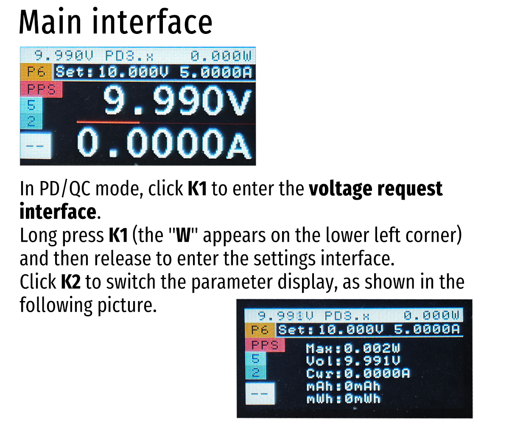
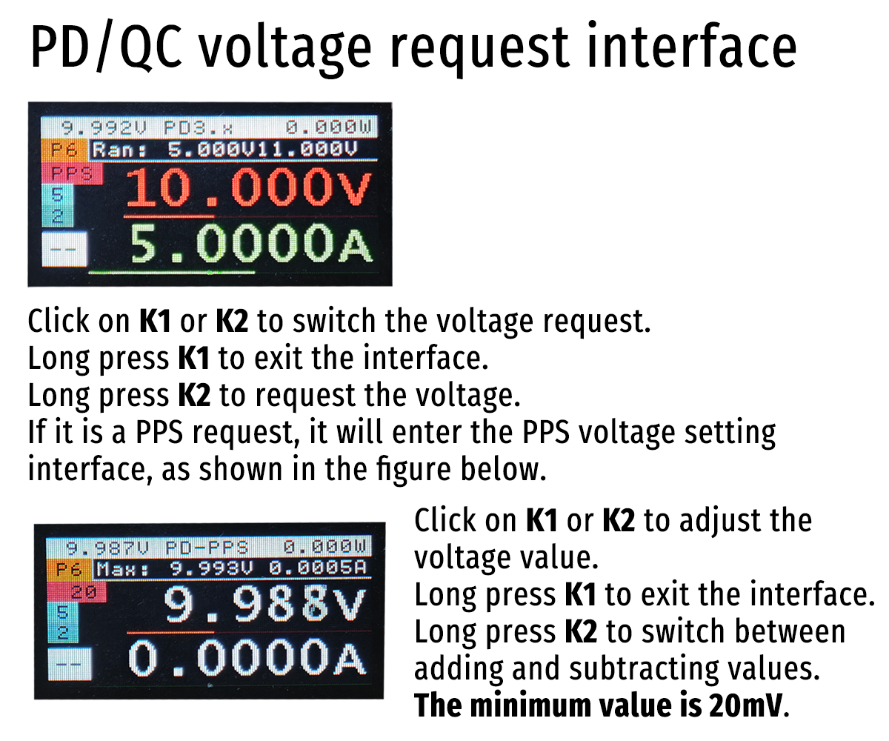
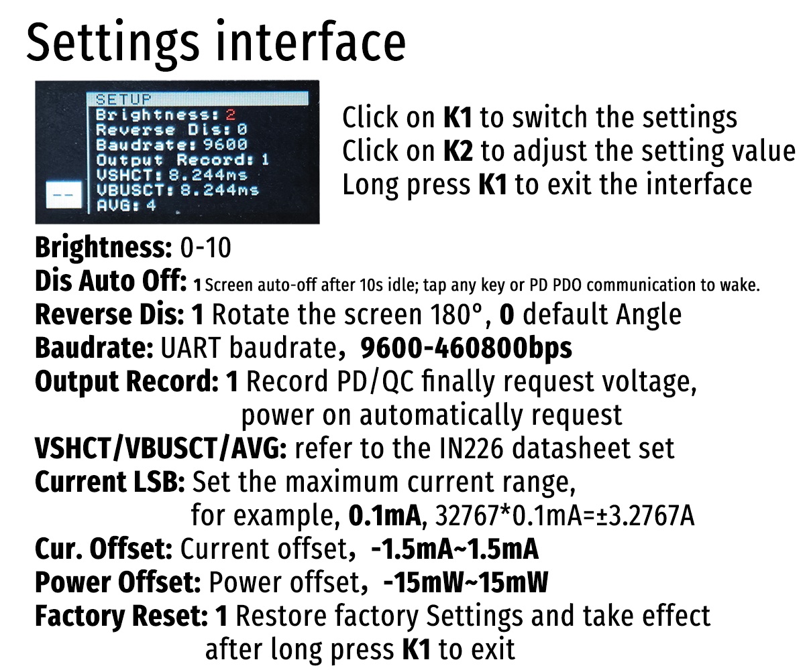

* [中文版本](./PowerMonitorMiniV1-使用说明-CN.md)

# WeAct Power Monitor Mini V1 User Manual

Wiring and specifications are in the [README](../README.md). This document covers the screens, setup menu, PC software / calibration and the communication protocol.

## Screens

### Main screen



The top bar shows input voltage, protocol version (PD3.x / QC / DC) and current power. The big numbers are live voltage and current; the line underneath alternates between the peak `Max:` value and the requested `Set:` value. The vertical strip on the left lists the PDOs reported by the charger: `P6` is the active step, `5` means five fixed PDOs and `2` means two PPS or AVS PDOs.

There are three display pages, switched with K2 short press:

| Page | Content |
| --- | --- |
| Main screen | Big voltage and current |
| Peak/energy page | Max power, Vol, Cur, mAh, mWh |
| Uptime page | UpT, HH:MM:SS |

K2 long press (release after `W.` appears) clears the peaks and mAh/mWh.

### Voltage request page



With PD/QC input, short-press K1 on the main screen to open this page. The vertical strip on the left is every PDO the charger advertises, numbered from 1, in the order fixed → PPS → AVS.

- K1 short press: next step; K2 short press: previous step.
- `Set:` is the voltage/current of this step. A PPS/AVS step shows `Ran:`, the voltage range that step allows.
- K2 long press: request this step. A fixed PDO is requested directly; for a PPS/AVS step the tuning page below opens automatically on success.
- K1 long press: exit without requesting.
- It also returns to the main screen after 10 s of inactivity.

### PPS/AVS page

The big numbers are the present voltage (orange) and current (green). K1/K2 short press changes the value by one step:

- Voltage steps: 20 mV / 100 mV / 500 mV / 1 V (AVS minimum step is 100 mV).
- Current steps: 50 mA / 100 mA / 500 mA / 1 A.
- Release after `W.` to change the step size; keep holding after `W.` to switch between adjusting voltage and current. The one being adjusted is highlighted (orange for voltage, green for current) and the other goes dim.
- Voltage is capped at the PDO's maximum, current at the maximum the charger advertises for that PDO, and never below 50 mA.
- K1 long press: confirm, send the present voltage/current to the charger and go back to the main screen.
- It returns to the main screen after 10 s of inactivity (nothing is sent).

The current you set is the current limit requested from the charger; whether it is actually honored depends on the charger.

## Button handling

- Short press: press and release; the action happens on release.
- Long press: hold for about 1 s, until `W.` appears in the button hint area at the bottom left, then release; the action happens on release.

K2 keeps repeating long-press events while held, so the PPS/AVS page separates "release after `W.`" (next step) from "keep holding after `W.`" (switch voltage/current).

## Setup menu

Long-press K1 on the main screen (release after `W.` appears). K1 short press changes item, K2 short press changes value, K1 long press saves and exits.

Values are written to flash on exit, which is why `Factory Reset` and `Reverse Dis` take effect only after leaving the menu; 10 s of inactivity also saves and exits.



| Item | Description | Value |
| --- | --- | --- |
| Brightness | Screen brightness | 0–10; 0 is treated as 1; default 2 |
| Dis Auto Off | Auto screen-off when idle | 0 off / 1 on; when on the screen turns off after 10 s, and any button or a PD PDO set command wakes it; default 0 |
| Reverse Dis | Rotate the screen 180° | 0 normal / 1 rotated; default 0 |
| Baudrate | UART header baudrate | 9600 / 19200 / 38400 / 57600 / 115200 / 230400 / 460800; default 9600 |
| Output Record | Remember the last PD/QC requested voltage and request it on power-up | 0 off / 1 on; default 0 |
| VSHCT | INA226 shunt voltage conversion time | 140 µs / 204 µs / 332 µs / 588 µs / 1.1 ms / 2.116 ms / 4.156 ms / 8.244 ms |
| VBUSCT | INA226 bus voltage conversion time | Same as above |
| AVG | INA226 averaging count (the count itself is shown) | 1 / 4 / 16 / 64 / 128 / 256 / 512 / 1024 |
| Cur. LSB | Current resolution, also sets the full-scale range (32767 × LSB) | 0.1–1.0 mA; default 2 (0.2 mA, about ±6.55 A) |
| Cur. Offset | Current zero offset | −1.5 to +1.5 mA, 0.1 mA step |
| Power Offset | Power zero offset | −15 to +15 mW |
| Factory Reset | Restore factory settings | Set to 1; applied on exit, then the board reboots |
| MFR | Manufacturer, read-only | WeAct Studio |
| MOD | Model, read-only | Power Monitor Mini V1 |
| S/N | Serial number, read-only | 12 hex digits |
| (last item) | Firmware version, read-only | e.g. V1.0.2.0_0A0B0C0D |

See the INA226 datasheet for the meaning of VSHCT / VBUSCT / AVG. A smaller Cur. LSB gives better resolution but less range, and vice versa.

## PC Software and Calibration

Prefer a desktop app over the browser:

- [PowerMonitorMiniV1_GUI](../Tools/PowerMonitorMiniV1_GUI/README.md): Windows exe (English and Chinese) or run the source. Requires firmware ≥ v1.0.0.3.
- [Third-party GUI by A8tor](../Tools/WeAct-PowerMonitor-GUI_by_A8tor/README.md): a third-party Windows tool with a power graph and average current calculation.

The calibration procedure is in the [GUI readme](../Tools/PowerMonitorMiniV1_GUI/README.md); in short:

1. Clear the display/actual values of both calibration points.
2. At 1 A and 3 A note the multimeter current and the on-screen (or GUI) reading.
3. Type them into the GUI and apply — the values are written to the device.
4. Verify at another current; the error should stay under 1 %.

## Communication Protocol

The device has two ports and they speak exactly the same protocol:

- **USB port**: USB CDC virtual COM port — just a COM port on the PC; any baudrate setting works (115200 is fine).
- **4-pin UART header**: 3.3 V TTL, cross-wired (device TX → adapter RX, device RX ← adapter TX). Baudrate comes from the `Baudrate` setup item, default 9600.

Both ports can be used at the same time.

### Frame format

Sending a read command: `command | 0x80` + terminator.

Device response:

- Fixed-length command: `command | 0x80` + data + terminator
- Variable-length command: `command | 0x80` + data length (1 B) + data + terminator

Sending a write command: `command` + data + terminator. **Write commands are not acknowledged**; read back if you want confirmation.

The terminator depends on the channel:

- USB CDC: always `0x0A`
- UART: CRC8, polynomial 0x31 (x⁸+x⁵+x⁴+1), initial value 0xFF, bit by bit, covering every byte except the CRC itself

Multi-byte values are little-endian. Do not poll faster than 50 ms — the firmware itself refreshes once per 50 ms.

### Write commands

| Command | Value | Frame | Description |
| --- | --- | --- | --- |
| Clear peaks and energy | 0x06 | `06 0A` | Peak voltage/current/power and mAh/mWh back to zero |
| Request PD step | 0x0A | `0A id V_L V_H 0A` | Voltage in mV. For a fixed PDO the voltage must equal that PDO's nominal voltage to take effect. Not saved on power loss |
| Request PD step + current | 0x0D | `0D id V_L V_H I_L I_H 0A` | For PPS/AVS; current in mA, i.e. the current limit. Not saved on power loss |
| System reset | 0x40 | `40 0A` | Reboot |
| Enter update mode | 0x41 | `41 A5 AA 0A` | Jump to the bootloader; the upgrade tool takes over from there |
| Factory reset | 0x45 | `45 0A` | Write default settings and reboot |
| Set LCD panel type | 0x46 | `46 type 0A` | 0 HAN / 1 BOE, stored in flash |
| Set shunt resistor | 0x47 | `47 mΩ 0A` | In mΩ, default 5, stored in flash, takes effect **after a power cycle** |
| Set current calibration | 0x48 | `48 20 bytes 0A` | Five int32, unit 0.1 mA: point 0 display/actual, point 1 display/actual, zero offset. Stored in flash |
| Set INA226 config | 0x49 | `49 LSB cfg_L cfg_H 0A` | LSB 1–10 (0.1–1.0 mA); applied immediately and stored in flash |

### Read commands

| Command | Value | Response data | Description |
| --- | --- | --- | --- |
| WHO_AM_I | 0x81 | len + `WeAct Studio Power Monitor Mini V1` | Model string |
| Live data | 0x82 | 12 B: voltage mV (u32), current 0.1 mA (i32), power mW (u32) | |
| Peak data | 0x83 | Same as 0x82 | Peak voltage/current/power |
| Energy | 0x84 | 8 B: mAh (u32), mWh (u32) | |
| Uptime | 0x85 | 4 B: seconds (u32) | |
| Input type | 0x87 | 1 B | 0/4 initialising, 1 PD, 2 QC, 3 DC |
| PD fixed PDOs | 0x88 | len (= count × 4) + 4 B each: voltage mV (u16), current mA (u16) | |
| PD PPS PDOs | 0x89 | len (= count × 6) + 6 B each: min voltage, max voltage, max current | |
| Current PD step | 0x8A | 3 B: id (u8), voltage mV (u16) | |
| PD AVS PDOs | 0x8B | len (= count × 6) + 6 B each: min voltage, max voltage, power W (u16) | |
| PDO counts | 0x8C | 3 B: fixed, PPS, AVS | |
| Current PD step + current | 0x8D | 5 B: id (u8), voltage mV (u16), current mA (u16) | |
| Firmware version | 0xC2 | len (17) + string | e.g. `V1.0.2.0_0A0B0C0D` |
| Serial number | 0xC3 | len (12) + string | 12 hex digits |
| LCD panel type | 0xC6 | 1 B | 0 HAN / 1 BOE |
| Shunt resistor | 0xC7 | 1 B | In mΩ |
| Current calibration | 0xC8 | 20 B: five int32 | Unit 0.1 mA |
| INA226 config | 0xC9 | 3 B: CurrentLSB, config register (u16) | |

Notes:

- In a variable-length response the length byte is the number of **data bytes**, not the number of PDOs: divide by 4 for fixed PDOs and by 6 for PPS/AVS.
- PD commands (0x0A, 0x0D, 0x88–0x8D) only answer while the input is PD. In QC or DC mode they stay silent — nothing is broken.
- Step ids start at 1, in the order fixed → PPS → AVS.

### Examples

Read live data once (USB channel):

```
send: 82 0A
recv: 82 06 27 00 00 | 00 00 00 00 | 00 00 00 00 | 0A
      voltage 9990 mV    current 0        power 0
```

Request step 2, the 9 V fixed PDO:

```
send: 0A 02 28 23 0A      9000 mV = 0x2328, little-endian 28 23
```

Request a PPS step (say there are 4 fixed PDOs, so PPS ids start at 5), 9.5 V with a 2 A limit:

```
send: 0D 05 1C 25 D0 07 0A    9500 mV = 0x251C, 2000 mA = 0x07D0
```

Enter update mode:

```
send: 41 A5 AA 0A
```

Using the bundled Python library (`Communication protocol/com_PowerMonitorMiniV1.py`):

```python
from com_PowerMonitorMiniV1 import com_PowerMonitorMiniV1

c = com_PowerMonitorMiniV1("COM19")      # add use_crc8=True for the UART header
print(c.output_data())                    # mV / 0.1 mA / mW
print(c.pd_pdo_num())
c.pd_pdo_set(2, 9000)                     # request step 2, 9 V
c.close()
```

Full definitions: [protocol spreadsheet](../Communication%20protocol/WeAct%20Studio%20PowerMonitorMiniV1%20Communication%20protocol_v1.3.xlsx).

---

[Back to README](../README.md)
