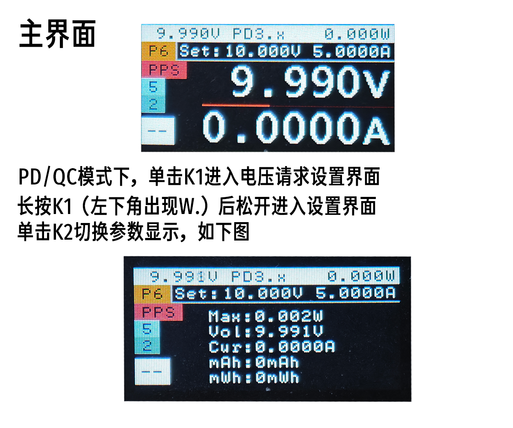
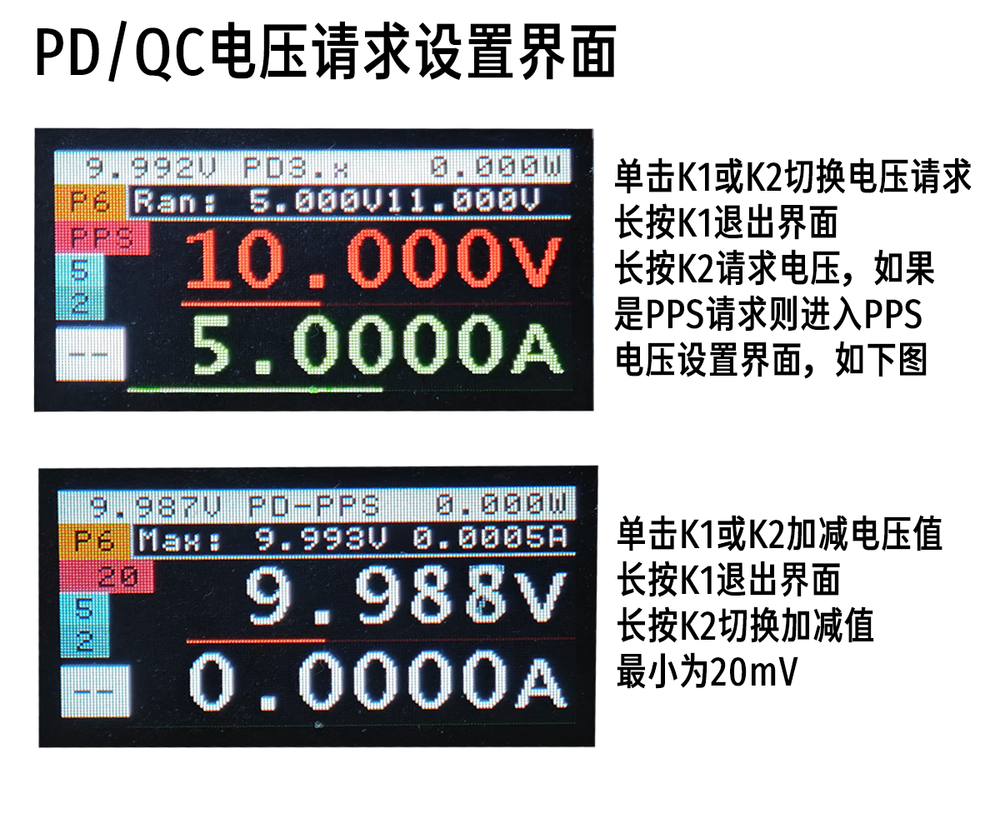
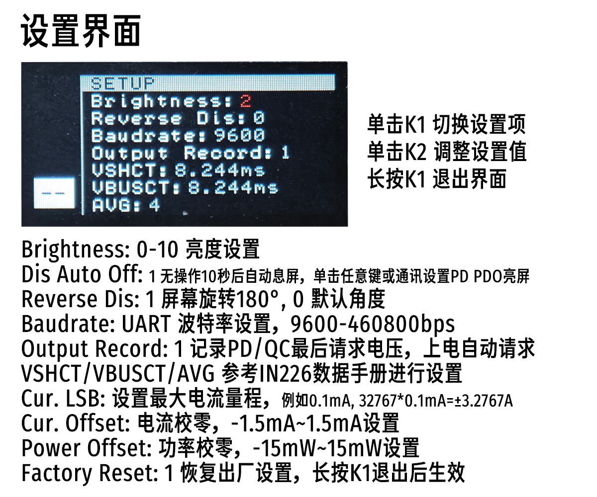

* [English version](./PowerMonitorMiniV1-User-Manual-EN.md)

# WeAct Power Monitor Mini V1 使用说明

产品的接线和参数见 [README](../README_zh.md)。本文讲界面、设置菜单、上位机与校准、通讯协议。

## 界面说明

### 主界面



顶栏是输入电压、协议版本（PD3.x / QC / DC）和当前功率。中间大字是实时电压和电流，下面一行状态会在峰值 `Max:` 和请求值 `Set:` 之间轮播。左边一竖条显示是充电器报上来的档位，P6为当前档位，5表示有5个Fixed PDO，2表示有2个PPS或AVS PDO。

显示一共三页，K2 短按切换：

| 页 | 内容 |
| --- | --- |
| 主界面 | 大字电压、电流 |
| 峰值/电量页 | Max 功率、Vol、Cur、mAh、mWh |
| 运行时间页 | UpT，HH:MM:SS |

K2 长按（出现 `W.` 后松开）清空峰值和 mAh/mWh。

### 电压请求设置页



PD/QC 输入时，主界面短按 K1 进入这一页。左边一竖条就是充电器报上来的全部档位，编号从 1 开始，顺序是固定档 → PPS → AVS。

- K1 短按：下一档；K2 短按：上一档。
- 显示 `Set:` 是本档的电压/电流；PPS/AVS 档显示 `Ran:`，表示这一档允许的电压范围。
- 长按 K2：请求这一档。固定档直接申请；PPS/AVS 档请求成功后会自动进入下面的调压页。
- 长按 K1：退出，不请求。
- 10 秒没有操作也会自动退回主界面。

### PPS/AVS 调压页

大字显示当前设定电压（橙色）和电流（绿色）。K1/K2 短按按步进加减：

- 电压步进：20 mV / 100 mV / 500 mV / 1 V（AVS 最小步进是 100 mV）。
- 电流步进：50 mA / 100 mA / 500 mA / 1 A。
- 出现 `W.` 后松开：换步进；出现 `W.` 后继续按住：切换到调电流（限流）。正在调的那一项是亮的（调电压橙字、调电流绿字），另一项变灰白。
- 电压最多调到这一档的上限，电流最多调到充电器在这一档报的最大电流，最少 50 mA。
- 长按 K1：确认并把当前电压/电流发给充电器，然后退回主界面。
- 10 秒没有操作自动退回主界面（不发送）。

调电流调的是"向充电器申请的电流上限"，能不能真的限住要看充电器。

## 按键判定

- 短按：按下再松开，松开时生效。
- 长按：按住约 1 秒，屏幕左下的按键提示区出现 `W.` 后松开，松开时生效。

K2 按住期间会重复触发长按，所以 PPS/AVS 页用"出现 `W.` 后松开"和"继续按住"来区分换步进和切调节对象。

## 设置菜单

主界面长按 K1（出现 `W.` 后松开）进入。K1 短按换项，K2 短按改值，K1 长按保存退出。

参数在退出设置菜单时才写进 flash，所以 `Factory Reset`、`Reverse Dis` 都是退出后生效；10 秒无操作也会自动保存退出。



| 设置项 | 说明 | 取值 |
| --- | --- | --- |
| Brightness | 屏幕亮度 | 0–10，0 按 1 处理；默认 2 |
| Dis Auto Off | 无操作自动息屏 | 0 关 / 1 开；开启后 10 s 无操作息屏，按任意键或收到 PD 档位设置命令亮屏；默认 0 |
| Reverse Dis | 屏幕旋转 180° | 0 正常 / 1 旋转；默认 0 |
| Baudrate | 串口接口（UART）波特率 | 9600 / 19200 / 38400 / 57600 / 115200 / 230400 / 460800，默认 9600 |
| Output Record | 记录 PD/QC 最后一次请求的电压，上电自动请求 | 0 关 / 1 开；默认 0 |
| VSHCT | INA226 分流电压转换时间 | 140 µs / 204 µs / 332 µs / 588 µs / 1.1 ms / 2.116 ms / 4.156 ms / 8.244 ms |
| VBUSCT | INA226 母线电压转换时间 | 同上 |
| AVG | INA226 平均次数（屏上直接显示次数） | 1 / 4 / 16 / 64 / 128 / 256 / 512 / 1024 次 |
| Cur. LSB | 电流分辨率，同时决定最大量程（32767 × LSB） | 0.1–1.0 mA，默认 2（0.2 mA，约 ±6.55 A） |
| Cur. Offset | 电流校零 | −1.5 ~ +1.5 mA，步进 0.1 mA |
| Power Offset | 功率校零 | −15 ~ +15 mW |
| Factory Reset | 恢复出厂设置 | 1 生效，退出设置时执行并重启 |
| MFR | 厂商，只读 | WeAct Studio |
| MOD | 型号，只读 | Power Monitor Mini V1 |
| S/N | 序列号，只读 | 12 位十六进制 |
| （最后一项） | 固件版本，只读 | 例如 V1.0.2.0_0A0B0C0D |

VSHCT / VBUSCT / AVG 的取值含义请对照 INA226 数据手册。Cur. LSB 调小分辨率高但量程小，调大反之。

## 上位机与校准

不想用浏览器，也可以用仓库里的 Python 图形工具：

- [PowerMonitorMiniV1_GUI](../Tools/PowerMonitorMiniV1_GUI/README_zh.md)：Windows 下直接双击 exe（中英文两个），或者跑源码。要求固件 ≥ v1.0.0.3。
- [第三方上位机 by A8tor](../Tools/WeAct-PowerMonitor-GUI_by_A8tor/README.md)：第三方写的 Windows 图形工具，带功率曲线和平均电流计算。

电流校准的流程在 [GUI 说明](../Tools/PowerMonitorMiniV1_GUI/README_zh.md) 里，大致是：

1. 先把两个校准点的显示值/实际值清零。
2. 用 1 A 和 3 A 两个电流点，分别记下万用表的实际值和屏幕（或 GUI）的显示值。
3. 填进 GUI 点应用，参数会写进设备。
4. 拿任意电流验证，误差应在 1 % 以内。

## 通讯协议

设备有两个通信口，命令完全一样：

- **USB 口**：USB CDC 虚拟串口，插上电脑就是一个 COM 口，波特率随便填（115200 即可）。
- **4 针串口接口**：3.3 V TTL 电平，交叉接线（设备 TX → 模块 RX，设备 RX ← 模块 TX），波特率由设置项 `Baudrate` 决定，默认 9600。

两个口可以同时用。

### 帧格式

发送读命令：`命令 | 0x80` + 结束符。

设备应答：

- 定长命令：`命令 | 0x80` + 数据 + 结束符
- 变长命令：`命令 | 0x80` + 数据长度(1 B) + 数据 + 结束符

发送写命令：`命令` + 数据 + 结束符。**写命令没有应答**，发完想确认就再读一次。

结束符按通道区分：

- USB CDC：固定 `0x0A`
- UART：CRC8。多项式 0x31（x⁸+x⁵+x⁴+1），初值 0xFF，逐位计算，覆盖除最后这个字节以外的全部字节

多字节数字一律小端。查询间隔不要小于 50 ms（固件本身就是 50 ms 刷新一轮）。

### 写命令

| 命令 | 值 | 帧 | 说明 |
| --- | --- | --- | --- |
| 清零峰值和电量 | 0x06 | `06 0A` | 峰值电压/电流/功率和 mAh/mWh 清 0 |
| 请求 PD 档位 | 0x0A | `0A id V_L V_H 0A` | 电压单位 mV。固定档必须填该档的标称电压才生效。掉电不保存 |
| 请求 PD 档位 + 电流 | 0x0D | `0D id V_L V_H I_L I_H 0A` | PPS/AVS 用，电流单位 mA，即限流值。掉电不保存 |
| 软复位 | 0x40 | `40 0A` | 重启 |
| 进入升级模式 | 0x41 | `41 A5 AA 0A` | 跳到 bootloader，之后交给升级工具 |
| 恢复出厂设置 | 0x45 | `45 0A` | 写回默认参数并重启 |
| 设置 LCD 面板类型 | 0x46 | `46 type 0A` | 0 HAN / 1 BOE，存 flash |
| 设置采样电阻 | 0x47 | `47 mΩ 0A` | 单位 mΩ，默认 5，存 flash，**断电重启后才生效** |
| 设置电流校准参数 | 0x48 | `48 20字节 0A` | 5 个 int32，单位 0.1 mA，依次为标定点 0 显示值/实际值、标定点 1 显示值/实际值、零点，存 flash |
| 设置 INA226 参数 | 0x49 | `49 LSB cfg_L cfg_H 0A` | LSB 取 1–10（0.1–1.0 mA），立即可用并写 flash |

### 读命令

| 命令 | 值 | 应答数据 | 说明 |
| --- | --- | --- | --- |
| WHO_AM_I | 0x81 | len + `WeAct Studio Power Monitor Mini V1` | 型号字符串 |
| 实时数据 | 0x82 | 12 B：电压 mV(u32)、电流 0.1 mA(i32)、功率 mW(u32) | |
| 峰值数据 | 0x83 | 同 0x82 | 峰值电压/电流/功率 |
| 电量 | 0x84 | 8 B：mAh(u32)、mWh(u32) | |
| 运行时间 | 0x85 | 4 B：秒(u32) | |
| 输入类型 | 0x87 | 1 B | 0/4 初始化中，1 PD，2 QC，3 DC |
| PD 固定档 | 0x88 | len（= 档数 × 4）+ 每档 4 B：电压 mV(u16)、电流 mA(u16) | |
| PD PPS 档 | 0x89 | len（= 档数 × 6）+ 每档 6 B：最小电压、最大电压、最大电流 | |
| 当前 PD 档 | 0x8A | 3 B：id(u8)、电压 mV(u16) | |
| PD AVS 档 | 0x8B | len（= 档数 × 6）+ 每档 6 B：最小电压、最大电压、功率 W(u16) | |
| PD 档位数量 | 0x8C | 3 B：固定档数、PPS 档数、AVS 档数 | |
| 当前 PD 档 + 电流 | 0x8D | 5 B：id(u8)、电压 mV(u16)、电流 mA(u16) | |
| 固件版本 | 0xC2 | len（17）+ 字符串 | 例如 `V1.0.2.0_0A0B0C0D` |
| 序列号 | 0xC3 | len（12）+ 字符串 | 12 位十六进制 |
| LCD 面板类型 | 0xC6 | 1 B | 0 HAN / 1 BOE |
| 采样电阻 | 0xC7 | 1 B | 单位 mΩ |
| 电流校准参数 | 0xC8 | 20 B：5 个 int32 | 单位 0.1 mA |
| INA226 参数 | 0xC9 | 3 B：CurrentLSB、配置寄存器(u16) | |

注意：

- 变长命令里的 len 是**数据字节数**，不是档数：固定档 len ÷ 4、PPS/AVS len ÷ 6 才是档数。
- PD 相关命令（0x0A、0x0D、0x88–0x8D）只在输入是 PD 时才应答。QC 和 DC 模式下不应答。
- 档位 id 从 1 开始，顺序是固定档 → PPS → AVS。

### 例子

读一次实时数据（USB 通道）：

```
发: 82 0A
回: 82 06 27 00 00 | 00 00 00 00 | 00 00 00 00 | 0A
    电压 9990 mV      电流 0          功率 0
```

申请第 2 档，9 V 固定档：

```
发: 0A 02 28 23 0A      9000 mV = 0x2328，小端 28 23
```

申请 PPS 档（假设固定档有 4 个，PPS 档 id 从 5 开始），9.5 V 限流 2 A：

```
发: 0D 05 1C 25 D0 07 0A    9500 mV = 0x251C，2000 mA = 0x07D0
```

进入升级模式：

```
发: 41 A5 AA 0A
```

用 Python 库（仓库里带的是 `Communication protocol/com_PowerMonitorMiniV1.py`）：

```python
from com_PowerMonitorMiniV1 import com_PowerMonitorMiniV1

c = com_PowerMonitorMiniV1("COM19")      # UART 口要加参数 use_crc8=True
print(c.output_data())                    # 电压 mV / 电流 0.1 mA / 功率 mW
print(c.pd_pdo_num())
c.pd_pdo_set(2, 9000)                     # 请求第 2 档 9 V
c.close()
```

详细定义见 [通讯协议表格](../Communication%20protocol/WeAct%20Studio%20PowerMonitorMiniV1%20Communication%20protocol_v1.3.xlsx)。

---

[返回 README](../README_zh.md)
