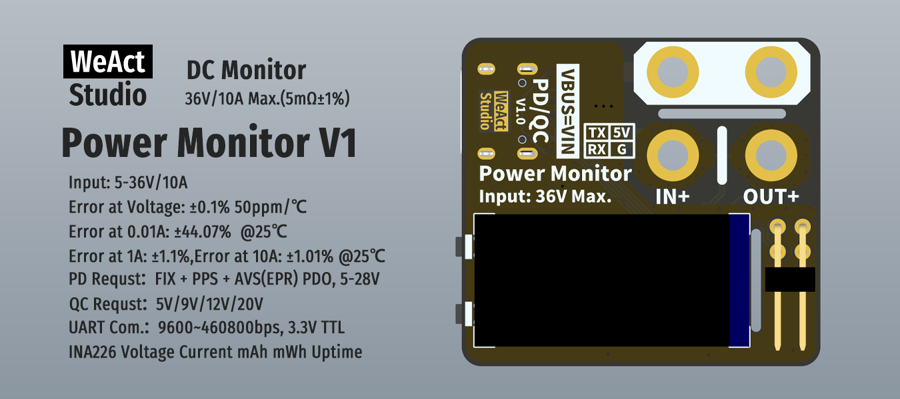
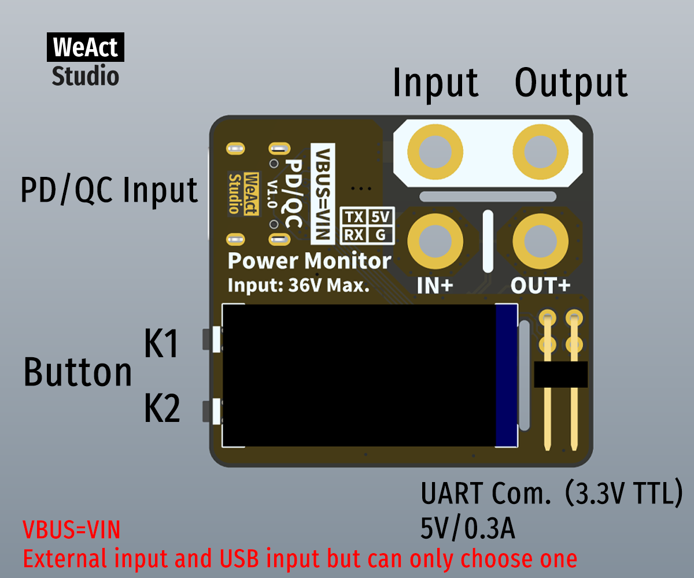
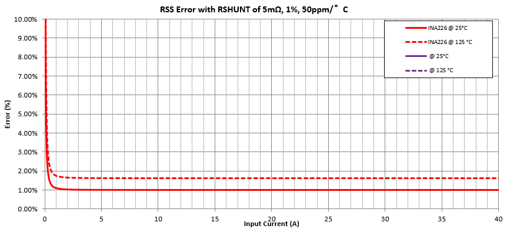
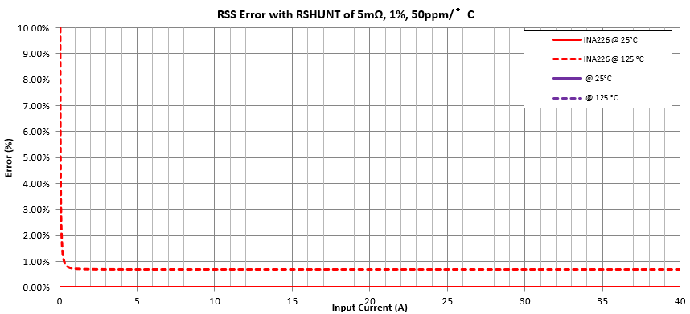

* [中文版本](./README_zh.md)

# WeActStudio.PowerMonitorMiniV1



A USB PD/QC trigger + power monitor with a screen. Plug in a charger and it negotiates the voltage for you, then measures voltage, current, power and accumulated energy and shows them on the display. The same data is available over a serial port.

Input and output are the same rail, with a 5 mΩ shunt in between: connect the supply to the input (USB-C or IN), the load to the output (OUT).

| Item | Value |
| --- | --- |
| Input | USB-C (PD 2.0/3.x incl. EPR AVS, QC 2.0) or IN external input (only one at a time), 36 V max (PD requests go up to 28 V) |
| Output | OUT, 5 mΩ shunt |
| Display | 1 mV / 0.1 mA / 1 mW resolution, 50 ms acquisition |
| Energy | mAh / mWh accumulation, resettable, not saved on power loss |
| Communication | USB CDC virtual COM port + 3.3 V TTL UART (9600–460800 bps) |
| Screen | Adjustable brightness, optional 10 s auto screen-off |

## Documents

- [User manual (English)](./Doc/PowerMonitorMiniV1-User-Manual-EN.md): every screen, all setup items, PC software and current calibration
- [Communication protocol](./Doc/PowerMonitorMiniV1-User-Manual-EN.md#communication-protocol): frame format, read/write command tables, examples and the Python library
- [Protocol spreadsheet (xlsx)](./Communication%20protocol/WeAct%20Studio%20PowerMonitorMiniV1%20Communication%20protocol_v1.3.xlsx): the original table
- [Firmware release notes](Firmwares/README.md)

## Interfaces



| Where | What |
| --- | --- |
| USB-C input | Charger or PC. A charger supplies power and lets the board request PD/QC voltages; a PC is used for serial communication |
| Input (IN) | External DC input, the same node as USB VBUS (VBUS = VIN) |
| Output (OUT) | Connect the load |
| G / TX / RX / 5V | 3.3 V TTL UART, works directly with a USB-UART adapter. The 5V pin outputs 5 V / 0.3 A to power the adapter |
| K1, K2 | Two buttons on the left of the screen |

> **Use external input and USB input one at a time.** If you power from IN and still want to talk to a PC, use the 4-pin UART header (the USB port must stay unplugged).

## Quick Start

1. Plug a PD/QC charger into USB-C (or feed external power into IN). The screen lights up; the top bar shows input voltage, protocol version and power.
2. The `PD3.x` / `QC` / `DC` label in the top bar is the detected input type. DC is a plain DC input.
3. To request a voltage: short-press K1 to open the voltage request page, pick a step with K1/K2, then long-press K2 to send the request.
4. To change brightness, baudrate, calibration and so on: long-press K1 on the main screen until `W.` appears, then release.

## Buttons

Short press = press and release. Long press = hold for about 1 s until `W.` appears in the button hint area at the bottom left, then release.

| Button | Main screen | Voltage request page | PPS/AVS page | Setup menu |
| --- | --- | --- | --- | --- |
| K1 short | With PD/QC input, open the voltage request page; nothing on DC input | Next step | Increase the value by one step | Next item |
| K1 long | Open the setup menu | Exit without requesting | Confirm and exit (send the request) | Save and exit |
| K2 short | Switch display page | Previous step | Decrease the value by one step | Change the value |
| K2 long | Clear peak voltage/current/power and mAh/mWh | Request the current step; a PPS/AVS step then opens the PPS/AVS page | Release after `W.`: change step size; keep holding after `W.`: switch between voltage and current | None |

Notes:

- There are three display pages, switched with K2 short press: main screen (big voltage/current), peak/energy page (Max power, Vol, Cur, mAh, mWh), uptime page (UpT, HH:MM:SS).
- The voltage request page and the PPS page return to the main screen after 10 s of inactivity; the setup menu saves and exits after 10 s.
- With PD input, the voltage request page lists every PDO the charger advertises (fixed + PPS + AVS, numbered from 1, in the order fixed → PPS → AVS).
- With QC input there are only four steps: 5 V / 9 V / 12 V / 20 V. Long-press K2 requests directly; there is no PPS page.
- Whether a request succeeds is up to the charger. If you ask for something it does not support, the actual voltage on screen simply will not change.

See the [user manual](./Doc/PowerMonitorMiniV1-User-Manual-EN.md) for what each screen shows and the fine details.

## Web Tools

No installation — connect from the browser:

- [Power Monitor Mini console](https://tools.weactstudio.com/PowerMonitorMini/): live values and trend chart, PD source capabilities, INA226 settings, current calibration, CSV export, soft reset / factory reset.
- [Firmware updater](https://tools.weactstudio.com/FirmwareUpdater/): pick a firmware and flash the device straight from the page.

Both pages use Web Serial, so they need a desktop Chrome / Edge / Opera (89 or newer). Mobile browsers, Safari and Firefox are not supported. The pages are served over https: open one, click "connect" and pick the device's COM port from the list.

There is also a Windows Python GUI in the repo — see [user manual · PC software and calibration](./Doc/PowerMonitorMiniV1-User-Manual-EN.md#pc-software-and-calibration).

## Firmware Update

Current firmware is V1.0.2.0; see [Firmwares/README.md](Firmwares/README.md) for release notes.

Three ways, pick one:

1. Web (easiest): connect the device and flash it from the [firmware updater](https://tools.weactstudio.com/FirmwareUpdater/).
2. Windows tool: extract `Firmwares/WeActStudio_Upgrade_Tool.7z`, run the exe, connect the cable, pick the fpk firmware, open the port and click send.
3. Python script: `Firmwares/WeActStudio_Upgrade_Tool_Python.zip`, then `python WeActStudio_Upgrade_Tool.py firmware.fpk`.

## Error Table

> Un-calibrated



> Calibrated



```
WeAct Studio Official Link
taobao: WeActStudio.taobao.com
aliexpress 1: WeActStudio.aliexpress.com
aliexpress 2: WeActStudioOne.aliexpress.com
github: github.com/WeActStudio
gitee: gitee.com/WeActStudio
blog: blog.weactstudio.com
```
