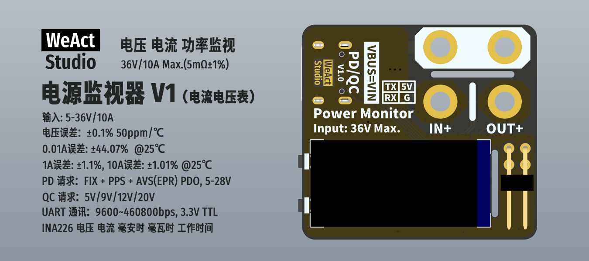
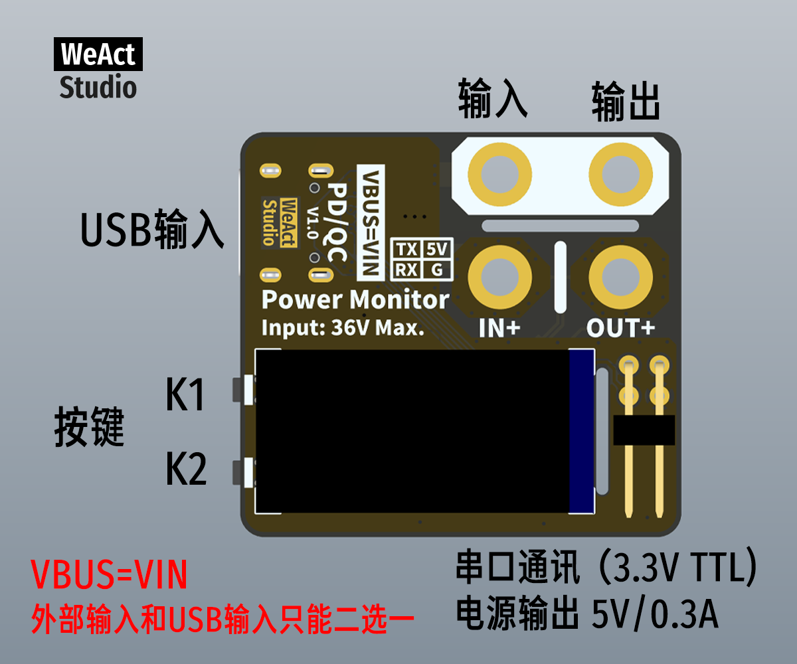
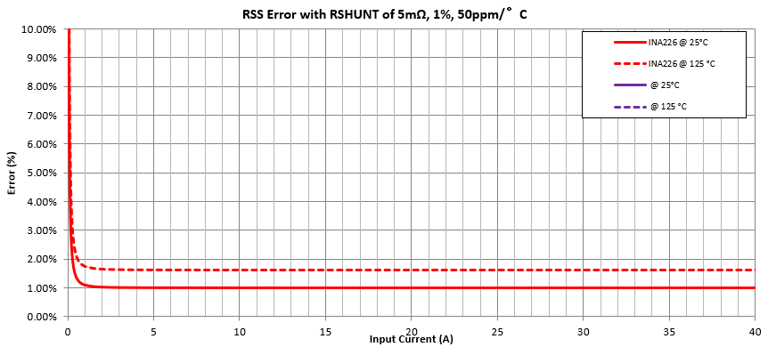
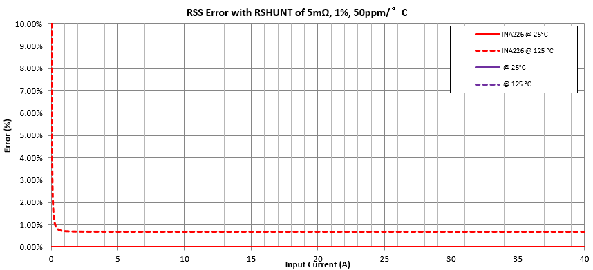

* [English version](./README.md)

# WeActStudio.PowerMonitorMiniV1



一块带屏幕的 USB PD/QC 电压诱骗 + 电源监视器。插上充电器，它替你去申请电压；顺路把电压、电流、功率、电量测出来显示在屏幕上，也能通过串口把数据发给电脑。

输入和输出是同一路，中间串一颗 5 mΩ 采样电阻：电源接输入（USB-C 或 IN），负载接输出（OUT）。

| 项目 | 参数 |
| --- | --- |
| 输入 | USB-C（PD 2.0/3.x，含 EPR AVS；QC 2.0）或 IN 外部输入（同时只能接一个），最高 36 V（PD 最高申请到 28 V） |
| 输出 | OUT，5 mΩ 采样电阻 |
| 显示 | 电压 1 mV、电流 0.1 mA、功率 1 mW 分辨率，采样刷新 50 ms |
| 电量统计 | mAh / mWh 累计，可清零，不支持掉电保存 |
| 通信 | USB CDC 虚拟串口 + 3.3 V TTL 串口（9600–460800 bps） |
| 屏幕 | 亮度可调，可设置 10 s 无操作自动息屏 |

## 文档

- [使用说明（中文）](./Doc/PowerMonitorMiniV1-使用说明-CN.md)：界面逐屏说明、设置菜单全部选项、上位机与电流校准
- [通讯协议](./Doc/PowerMonitorMiniV1-使用说明-CN.md#通讯协议)：帧格式、读写命令表、例子和 Python 库用法
- [通讯协议表格（xlsx）](./Communication%20protocol/WeAct%20Studio%20PowerMonitorMiniV1%20Communication%20protocol_v1.3.xlsx)：原始表格
- [固件版本说明](Firmwares/README_zh.md)

## 接口说明



| 位置 | 说明 |
| --- | --- |
| USB-C 输入 | 接充电器/电脑。充电器用来供电和申请 PD/QC 电压，电脑用于串口通信 |
| 输入（IN） | 外部直流输入，和 USB 输入是同一个节点（VBUS = VIN） |
| 输出（OUT） | 接负载 |
| G / TX / RX / 5V | 3.3 V TTL 串口，可直接接 USB 转串口模块；5V 脚对外输出 5 V / 0.3 A，能给串口模块供电 |
| K1、K2 | 屏幕左侧上下两个按键 |

> **外部输入和 USB 输入只能二选一。** 用 IN 外部供电、又想连电脑看数据时，请用 4 针串口头（这时 USB 口必须空着）。

## 快速上手

1. USB-C 接一个支持 PD 或 QC 的充电器（或者从 IN 接外部电源），屏幕亮起，顶栏显示输入电压、协议版本和功率。
2. 顶栏的 `PD3.x` / `QC` / `DC` 就是识别到的输入类型。DC 是普通直流输入。
3. 想申请电压：短按 K1 进电压请求页 → K1/K2 选档 → 长按 K2 发出请求。
4. 想改亮度、波特率、校准这些：在主界面长按 K1，出现 `W.` 后松开，进设置菜单。

## 按键

短按 = 按一下松开；长按 = 按住约 1 秒，屏幕左下的按键提示区出现 `W.` 后松开。

| 按键 | 主界面 | 电压请求设置页 | PPS/AVS 调压页 | 设置菜单 |
| --- | --- | --- | --- | --- |
| K1 短按 | PD/QC 输入时进入电压请求页；DC 输入时无效 | 下一档 | 电压/电流值增加一个步进 | 下一项 |
| K1 长按 | 进入设置菜单 | 退出，不请求 | 确认并退出（发出请求） | 保存并退出 |
| K2 短按 | 切换显示页 | 上一档 | 电压/电流值减少一个步进 | 修改数值 |
| K2 长按 | 清零峰值电压/电流/功率和 mAh/mWh | 请求当前档；若为 PPS/AVS 档则进入调压页 | 出现 `W.` 后松开：切换步进；出现 `W.` 后持续按住：切换调电压/调电流 | 无 |

几点补充：

- 显示页一共三页，K2 短按切换：主界面（大字电压电流）→ 峰值/电量页（Max 功率、Vol、Cur、mAh、mWh）→ 运行时间页（UpT，HH:MM:SS）。
- 电压请求页和 PPS 调压页 10 秒不动会自动退回主界面；设置菜单 10 秒不动会自动保存退出。
- 输入是 PD 时，电压请求页列出的就是充电器报上来的全部 PDO（固定档 + PPS + AVS，编号从 1 开始，顺序是固定档 → PPS → AVS）。
- 输入是 QC 时只有 5V / 9V / 12V / 20V 四档，长按 K2 直接请求，没有调压页。
- 能不能请求成功取决于充电器。申请了它不支持的电压，屏幕上的实际电压不会变。

每个界面的显示内容和操作细节见 [使用说明](./Doc/PowerMonitorMiniV1-使用说明-CN.md)。

## 网页工具

不用装软件，浏览器直接连设备：

- [Power Monitor Mini 监控台](https://tools.weactstudio.com/PowerMonitorMini/)：看实时数值和趋势图、读 PD 源能力、改 INA226 参数、做电流校准、导出 CSV、软复位/恢复出厂。
- [固件升级](https://tools.weactstudio.com/FirmwareUpdater/)：连上设备选固件，直接在网页里刷。

两个页面用的都是浏览器的 Web Serial 功能，要求桌面版 Chrome / Edge / Opera（89 及以上），手机浏览器、Safari、Firefox 用不了。页面是 https 的，打开后点"连接"，在弹出的串口列表里选设备对应的 COM 口就行。

不想用浏览器的话，仓库里也有 Windows 的 Python 图形工具，见 [使用说明 · 上位机与校准](./Doc/PowerMonitorMiniV1-使用说明-CN.md#上位机与校准)。

## 固件升级

当前固件 V1.0.2.0，版本说明见 [Firmwares/README_zh.md](Firmwares/README_zh.md)。

三种升级方式，任选一种：

1. 网页（最省事）：连上设备，打开 [固件升级页面](https://tools.weactstudio.com/FirmwareUpdater/) 选固件刷。
2. Windows 工具：解压 `Firmwares/WeActStudio_Upgrade_Tool.7z`，运行 exe，连数据线，选 fpk 固件，打开串口，点发送。
3. Python 脚本：用 `Firmwares/WeActStudio_Upgrade_Tool_Python.zip`，`python WeActStudio_Upgrade_Tool.py 固件.fpk`。

## 误差表

> 未校准



> 校准后



```
WeAct Studio Official Link
taobao: WeActStudio.taobao.com
aliexpress 1: WeActStudio.aliexpress.com
aliexpress 2: WeActStudioOne.aliexpress.com
github: github.com/WeActStudio
gitee: gitee.com/WeActStudio
blog: blog.weactstudio.com
```
